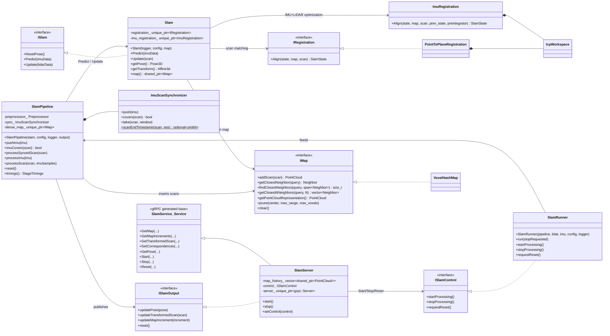

# mslam Core Class Model

This document summarizes the main runtime structure: the estimator (`Slam`),
the per-scan sequence (`SlamPipeline`), the live loop (`SlamRunner`), the map
(`IMap`) and the gRPC endpoint (`SlamServer`).

At a high level:
- `Slam` is the state estimator: `Predict` (IMU dead reckoning) and `Update`
  (scan-to-map registration). It does no I/O and owns no threads.
- `SlamPipeline` is the synchronous per-scan sequence: predict with the IMU
  samples of the scan's window (paired by timestamp, `ImuScanSynchronizer`),
  preprocess the scan, `Slam::Update`, insert into the map(s) and
  publish to an `ISlamOutput`. The live loop and the offline benchmark
  (`bench_slam`) both call it, so they run the same code.
- `SlamRunner` is the live loop: it pulls scans and IMU samples from the
  sensors (`SensorInput`) and feeds the pipeline. It implements `ISlamControl`;
  start / stop / reset requests may come from any thread and are applied by the
  loop thread between two scans. Stopping is a flag passed to `run()`;
  `src/main.cc` owns the signal handlers.
- `SlamServer` implements `ISlamOutput` (the pipeline publishes pose, scan and
  map increment to it) and forwards the `Start` / `Stop` / `Reset` RPCs to an
  `ISlamControl`. Neither the pipeline nor the runner depend on the server.
- `VoxelHashMap` is the concrete `IMap` implementation and is selected by
  configuration. Its points live in one contiguous pool, one fixed-size chunk
  per voxel, behind a `tsl::robin_map`.
- Registration: `IRegistration` is a pure interface (`Align(state, map, scan)`).
  `PointToPlaneRegistration` implements it. `ImuRegistration` needs the
  previous state and the preintegrated IMU data, so it is not an
  `IRegistration` and exposes only its own `Align`. Both own an `IcpWorkspace`
  (configuration, correspondence search, normals, constraint buffers).
- `Point3PlaneDistance` is the point-to-plane model with an analytical se(3)
  jacobian and a scalar residual; both registrations use it through
  `moptim::AnalyticalCost`.

## Time convention

One timeline, the sensors' nanosecond clock; every scan is registered at its
last point's time.

- **Scan window.** A scan covers `[t0, t_end]`: `t0 = scan.header.timestamp` is
  the first point (the first packet), and
  `t_end = t0 + (N - 1) / preprocessor.points_per_second` the last. This is the
  rule `deskewInto` uses for the point times.
- **Deskew reference.** All deskew overloads express the points in the sensor
  frame at `t_end` (the last point is unchanged, the first is moved the most).
- **Which IMU samples belong to a scan.** Those with `timestamp <= t_end`, not
  yet used by an earlier scan, taken by timestamp and not by arrival
  (`ImuScanSynchronizer`; LiDAR and IMU are separate streams). Later samples
  wait for the next scan. The deskew gets the same samples.
- **Where the state time sits.** On `t_end` when `Slam::Update` runs. When
  `t_end` falls between two samples the interval is split: the synchroniser
  returns a copy of the later sample stamped `t_end`, which `SlamPipeline`
  feeds first (integrating `[last sample, t_end]`); the real sample then
  integrates `[t_end, sample]`. So every IMU interval is integrated exactly
  once, and the IMU clock in `Slam` is not touched at a scan (the IMU path of
  `Slam::Update` only restarts the preintegrator). The clock is re-seeded, and
  the interval skipped, at start-up, after a backwards step or a gap over 1 s,
  after the init scans and after a LiDAR-only registration
  (`ResetImuPreintegration`: the velocity is dropped there on purpose). An
  interval longer than 1 s is not split: scans inside an IMU outage get no IMU
  data and register LiDAR-only.
- **Waiting.** `SlamRunner` feeds every IMU sample to `pushImu` as it arrives
  and holds a scan until `imuCovers(scan)` (the newest IMU timestamp reached
  `t_end`), for at most `SlamRunner::kMaxImuWait` (50 ms: half a scan period,
  ten IMU periods). On expiry it logs a warning, counts it and processes the
  scan with what has arrived. Scans are never reordered; the sensor input keeps
  one waiting scan, replacing it counts a dropped scan (logged). `bench_slam`
  holds a scan until coverage arrives or the recording ends.
- **No IMU (`with_imu` false).** Samples are ignored, every scan is covered
  and registers LiDAR-only. **No `points_per_second`.** There is no `t_end`, so
  a scan is always covered and takes every queued sample (the old arrival
  grouping, no split); deskew is off in that mode anyway.
- `Slam::registrationStats()` counts the scans registered through the IMU path
  versus LiDAR-only, and the mean size of the first registration round's pose
  increment (how wrong the IMU-predicted prior was); `bench_slam` prints it.

## Threads and control

- The SLAM thread runs `SlamRunner::run`. It is the only thread that touches
  `Slam`, the maps and the pipeline.
- gRPC handler threads call `SlamServer::Start/Stop/Reset`, which call the
  runner's `ISlamControl`. `startProcessing`/`stopProcessing` set an atomic
  flag; `requestReset` stops processing and posts a request that the loop
  applies before the next scan (`SlamPipeline::reset`, which clears the pose,
  both maps and the server's accumulated map history). Nothing clears the map
  or state from another thread.
- The server's stream and `GetMap` handlers only read data published through
  `ISlamOutput`, under the server's own mutexes. Published clouds are
  `shared_ptr<const PointCloud>`; the latest map increment and the newest
  history entry are the same object.

## Offline benchmark

`test/bench_slam.cc` (target `bench_slam`, built on demand, not in CTest) reads a
`.pbscan` synchronously and drives `SlamPipeline` as fast as possible; see the
readme for how to run it.

## Notes

- `SlamServer` is both a transport adapter (gRPC) and a live data publisher
	for pose and point-cloud streams.
- The map abstraction allows switching map backends without changing the SLAM
	pipeline logic.
