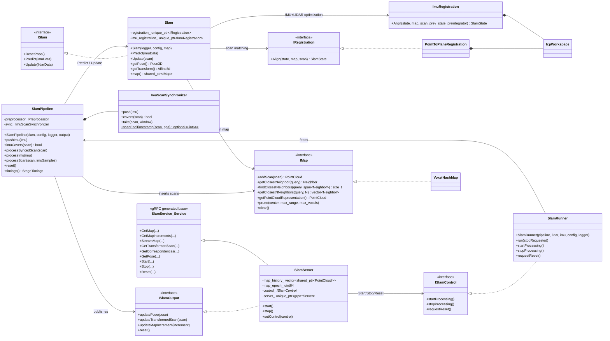

# mslam Core Class Model

This document summarizes the main runtime structure: the estimator (`Slam`),
the per-scan sequence (`SlamPipeline`), the live loop (`SlamRunner`), the map
(`IMap`) and the gRPC endpoint (`SlamServer`).

At a high level:
- `Slam` is the state estimator: `Predict` (IMU dead reckoning) and `Update`
  (scan-to-map registration). It does no I/O and owns no threads.
- `SlamPipeline` is the synchronous per-scan sequence: predict with the IMU
  samples of the scan's window (paired by timestamp, `ImuScanSynchronizer`),
  preprocess the scan, `Slam::Update`, insert into the map(s) and
  publish to an `ISlamOutput`. The live loop and the offline benchmark
  (`bench_slam`) both call it, so they run the same code.
- `SlamRunner` is the live loop: it pulls scans and IMU samples from the
  sensors (`SensorInput`) and feeds the pipeline. It implements `ISlamControl`;
  start / stop / reset requests may come from any thread and are applied by the
  loop thread between two scans. Stopping is a flag passed to `run()`;
  `src/main.cc` owns the signal handlers. In remote mode `src/main.cc` asks the
  sensor server for an IMU queue of 1000 (the depth of `SensorInput`'s IMU
  buffer; about 5 s at 200 Hz, so a link stall shorter than that costs no IMU
  sample) and a scan queue of 1 (`SensorInput` keeps only the newest scan).
- `SlamServer` implements `ISlamOutput` (the pipeline publishes pose, scan and
  map increment to it) and forwards the `Start` / `Stop` / `Reset` RPCs to an
  `ISlamControl`. Neither the pipeline nor the runner depend on the server.
- `VoxelHashMap` is the concrete `IMap` implementation and is selected by
  configuration. Its points live in one contiguous pool, one fixed-size chunk
  per voxel, behind a `tsl::robin_map`.
- Registration: `IRegistration` is a pure interface (`Align(state, map, scan)`).
  `PointToPlaneRegistration` implements it. `ImuRegistration` needs the
  previous state and the preintegrated IMU data, so it is not an
  `IRegistration` and exposes only its own `Align`. Both own an `IcpWorkspace`
  (configuration, correspondence search, normals, constraint buffers).
- `SE3Manifold` (`SE3Manifold.hh`) is the pose manifold the registrations hand
  to moptim: 12 doubles `[R | t]` (the 3x4 matrix, column-major), a 6-vector
  tangent `[rho, omega]`, `plus(T, delta) = se3Exp(delta) * T`. The optimizer
  variable is the pose itself (the full state for `ImuRegistration`, through a
  product manifold with a Euclidean block for velocity and biases).
- `Point3PlaneDistance` is the point-to-plane model with a scalar residual and
  the jacobian with respect to the left increment at zero (`-n`, `-(q x n)`);
  both registrations use it through `moptim::AnalyticalCost`. Its inputs are
  source points already moved by the pose of the current round, which the
  model is told as `source_pose`.

## Time convention

One timeline, the sensors' nanosecond clock; every scan is registered at its
last point's time.

- **Scan window.** A scan covers `[t0, t_end]`: `t0 = scan.header.timestamp` is
  the first point (the first packet), and
  `t_end = t0 + (N - 1) / preprocessor.points_per_second` the last. This is the
  rule `deskewInto` uses for the point times.
- **Deskew reference.** All deskew overloads express the points in the sensor
  frame at `t_end` (the last point is unchanged, the first is moved the most).
- **Which IMU samples belong to a scan.** Those with `timestamp <= t_end`, not
  yet used by an earlier scan, taken by timestamp and not by arrival
  (`ImuScanSynchronizer`; LiDAR and IMU are separate streams). Later samples
  wait for the next scan. The deskew gets the same samples.
- **Where the state time sits.** On `t_end` when `Slam::Update` runs. When
  `t_end` falls between two samples the interval is split: the synchroniser
  returns a copy of the later sample stamped `t_end`, which `SlamPipeline`
  feeds first (integrating `[last sample, t_end]`); the real sample then
  integrates `[t_end, sample]`. So every IMU interval is integrated exactly
  once, and the IMU clock in `Slam` is not touched at a scan (the IMU path of
  `Slam::Update` only restarts the preintegrator). The clock is re-seeded, and
  the interval skipped, at start-up, after a backwards step or a gap over 1 s,
  after the init scans and after a LiDAR-only registration
  (`ResetImuPreintegration`: the velocity is dropped there on purpose). An
  interval longer than 1 s is not split: scans inside an IMU outage get no IMU
  data and register LiDAR-only.
- **Waiting.** `SlamRunner` feeds every IMU sample to `pushImu` as it arrives
  and holds a scan until `imuCovers(scan)` (the newest IMU timestamp reached
  `t_end`), for at most `SlamRunner::kMaxImuWait` (50 ms: half a scan period,
  ten IMU periods). On expiry it logs a warning, counts it and processes the
  scan with what has arrived. Scans are never reordered; the sensor input keeps
  one waiting scan, replacing it counts a dropped scan (logged). `bench_slam`
  holds a scan until coverage arrives or the recording ends.
- **No IMU (`with_imu` false).** Samples are ignored, every scan is covered
  and registers LiDAR-only. **No `points_per_second`.** There is no `t_end`, so
  a scan is always covered and takes every queued sample (the old arrival
  grouping, no split); deskew is off in that mode anyway.
- `Slam::registrationStats()` counts the scans registered through the IMU path
  versus LiDAR-only, and the mean size of the first registration round's pose
  increment (how wrong the IMU-predicted prior was); `bench_slam` prints it.

## IMU fusion modes

`slam.imu_fusion` (used when `imu` is on) selects how `Slam::Update` uses the
IMU. `Slam::Predict` is the same in both: it integrates every sample forward
into `state_` (dead reckoning) and feeds the `ImuPreintegrator`.

- **`preintegration_factor` (default, A).** `ImuRegistration` solves one joint
  problem over the new state (pose, velocity, gyro and accel bias) and the
  previous state's velocity and biases. Costs: point-to-plane scan residuals
  plus `ImuPreintegrationFactor` (weight 0.003) tying the two states to the
  preintegrated measurements. Velocity and biases are estimated, so a wrong
  bias is corrected by the scans.
- **`dead_reckoning` (B).** The dead-reckoned `state_` is only the initial
  guess of `PointToPlaneRegistration`, a pose-only (6-DOF) problem with the
  scan term alone: no IMU term, nothing constrains the IMU error beyond the
  prior. One pose does not observe velocity, so it is re-derived from the
  registered poses, `v = (p_k - p_{k-1}) / dt` with `dt` the preintegrated time
  (the dead-reckoned velocity on the first scan). The biases are carried over
  unchanged (zero: nothing estimates them).

Both restart only the preintegrator at a scan and keep the IMU clock running
(see "Time convention"): the interval across the scan boundary belongs to the
next scan. `ResetImuPreintegration()` is not used by B because it would zero
the velocity and re-seed the clock. A scan with no integrated IMU time
registers LiDAR-only in both modes. `bench_slam --imu-fusion` selects the mode
per run and `--trajectory` plus `test/plot_imu_fusion.py` compare two runs;
the first-round correction (how far the prior was from the registered pose) is
recorded for both.

## Threads and control

- The SLAM thread runs `SlamRunner::run`. It is the only thread that touches
  `Slam`, the maps and the pipeline.
- gRPC handler threads call `SlamServer::Start/Stop/Reset`, which call the
  runner's `ISlamControl`. `startProcessing`/`stopProcessing` set an atomic
  flag; `requestReset` stops processing and posts a request that the loop
  applies before the next scan (`SlamPipeline::reset`, which clears the pose,
  both maps and the server's accumulated map history). Nothing clears the map
  or state from another thread.
- The server's stream and `GetMap` handlers only read data published through
  `ISlamOutput`, under the server's own mutexes. Published clouds are
  `shared_ptr<const PointCloud>`; the latest map increment and the newest
  history entry are the same object. `StreamMap` gives each client its own
  cursor `(epoch, offset)` into `map_history_`: the handler thread copies chunk
  pointers under the mutex (a bounded number at a time) and concatenates and
  writes outside it, and `reset()` bumps the epoch in O(1) so open streams
  announce it; see the readme.

## Pose-graph strategy

`slam.strategy` selects the estimator (`odometry`, the default, or
`pose_graph`; see the readme). `pose_graph` keeps the odometry exactly as it is
and adds a back end that corrects its drift with loop closures. The pipeline
owns a `PoseGraphBackend` (`include/mslam/slam/posegraph/`) only in this mode;
with `odometry` nothing of it exists or runs, and the results are bit for bit
those of the odometry alone.

**Frames.** `Slam`, the registrations and the registration map stay in the
**odom** frame, the frame of the drifting odometry. The back end only reads
their output and never feeds anything back. Its result is `T_map_odom =
pose_kf * pose_kf_odom^-1` of the newest keyframe: the correction of the odom
frame into the **map** frame, in which the optimized keyframes live. Exactly the
identity until the first optimization. The pipeline applies it on the output
side only: the published pose, transformed scan and per-scan map increment are
`T_map_odom * odom`. The registration map is never rebuilt.

**Keyframes and mini maps.** The msensor driver already accumulates each scan
(`accumulate_scan_count`), so a scan is dense enough and there is no minimum
scan count. `KeyframeSelector` opens a keyframe when a scan moved more than
`keyframe_distance` or turned more than `keyframe_angle` from the current one
(or `keyframe_max_interval_s` passed). Every scan between two keyframes, the
one that opens the keyframe included, goes into two clouds of that keyframe,
thinned per `map.resolution` voxel (so memory and per-scan cost are bounded by
the occupied voxels) and expressed in the keyframe's own frame once it is
sealed:
- the **view** (`MiniMapBuilder`): everything the keyframe saw. Only the loop
  verification reads it, because a keyframe that revisits a place owns almost
  nothing there. Views of different keyframes overlap.
- the **owned mini map** (`OwnedMapBuilder`): only the voxels no earlier keyframe
  owns. A voxel belongs to the FIRST keyframe that observes it, decided on the
  voxel in the odom frame, which never changes (so no re-keying after an
  optimization). Sealed voxels are a hash set that only grows. With
  `map.max_points_per_voxel` 1 the open keyframe keeps one centroid per voxel it
  owns, emitted in first-seen order; with more it keeps the first N raw points of
  each voxel it owns (the rule of `VoxelHashMap::addScan`) in arrival order, and
  keeps filling its voxels until N while it is open. Sealing freezes its voxels,
  filled or not, and a later keyframe never refills them. Everything published
  (the keyframe stream, the `StreamMap` re-send, `--save-map`) is this cloud, so
  the published map has each voxel owned once and at most N points in it. The
  view stays one centroid per voxel, so loop verification does not depend on N.
`onScan` returns what this scan added to the open keyframe's owned voxels (one
mean point per newly owned voxel at N = 1; at N > 1 every accepted point, also
in voxels the keyframe already owned), and the pipeline publishes those, moved
by `T_map_odom`, as the per-scan map increment instead of the registration map's
own (odometry keeps the latter). At N > 1 the sealed cloud is the concatenation
of the increments published while the keyframe was open. Ownership is decided on
the caller thread; the worker only ever sees sealed clouds.

A keyframe is sealed (its clouds final) when the next one opens. The first one
is the **origin keyframe**: the pipeline calls `sealOpenKeyframe()` after the
last seed scan, so keyframe 0 is exactly the seed scans at the identity pose
(the gauge), in the graph and published before the first registered scan, and the
next scan opens keyframe 1. The interval trigger is ignored for seed scans, so a
short `keyframe_max_interval_s` cannot split them. The back end gets each scan
with the time of its last point, the registration time (see "Time convention").

**Loop closure.** When a keyframe is sealed it gets an odometry edge from its
predecessor (`pose_odom_a^-1 * pose_odom_b`, information from
`odometry_sigma_*`), and `LoopCloser` looks for the nearest keyframe whose graph
pose is within `loop_search_radius` and at least `loop_min_separation` keyframes
older. It verifies it with `ScanSequenceRegistration`: the target is the
candidate's view plus `loop_submap_keyframes` neighbours' views on each side
(in the candidate's frame, through their current graph poses), the new keyframe's
view starts from the graph's relative pose. Gates: `matched / used points >=
loop_min_matched_fraction` and `rms <= loop_max_rms`; ICP uses a 0.2 m
correspondence gate and 0.1 m map voxels. An accepted candidate becomes a
robust (Huber) loop edge with information from `loop_sigma_*`; each attempt is
logged at debug. There is no policy beyond that: in a room-scale recording almost
every keyframe finds a candidate and verifies.

**Optimizer.** `PoseGraphOptimizer`: sparse Levenberg-Marquardt over keyframes
1..N-1 (`Eigen::SparseMatrix`, `SimplicialLDLT`), run when a loop edge was
added. The residual is `se3Log(Z^-1 * T_i^-1 * T_j)` in the `[rho, omega]`
order of `SE3.hh` with the LEFT increment `T <- se3Exp(d) * T`, as in
`SE3Manifold`. The Jacobians are `dr/dd_j = Jl^-1(r) * Ad((T_i Z)^-1)` and
`dr/dd_i = -dr/dd_j`, checked against central finite differences
(`test_pose_graph_optimizer`); keyframe 0 never moves.

**Threads.** With `pose_graph.synchronous` the whole back end runs inside
`onScan`, so a replay is deterministic (`bench_slam`, the integration test).
Otherwise sealed keyframes go through a queue to one worker thread that closes
loops, optimizes and renders, and the SLAM thread only inserts points into the
open mini map. The worker publishes an immutable `PoseGraphResult` (versions,
`T_map_odom`, poses, edges, keyframe clouds in both frames, counters) through a
`shared_ptr`; the pipeline reads it between scans, so every `ISlamOutput` call
stays on the SLAM thread. Both modes process the same keyframes in the same
order, so the graph after `flush()` is identical (the number of map re-sends can
differ, because the worker batches results). `finish()` seals the open keyframe
at the end of a recording and drains the worker. Each optimization logs two
info lines: the cost and chi2/dof (`2 * cost / (6 * edges)`, about 1 when the
residuals match their sigmas) before and after, whether it converged, and for
each new loop edge its residual in mm and mrad before and after plus its
verification RMS and matched %; then the max and RMS residual of the odometry
and loop edges after it, the worst edge by sigma-normalised error, and the
largest keyframe displacement and the change of `T_map_odom` (`bench_slam
--log-level info` shows them). Each keyframe also logs one info line as it enters
the graph: its id and time since keyframe 0, the scans and time it covers, why it
closed (`seed`, `distance`, `angle`, `interval` or `finish`), its odom pose (and
the map pose once an optimization made it differ), the step from the previous
keyframe, and the points it owns (with the running total) and holds in its view. Known limits: views still
overlap in memory (the total is printed by `bench_slam`); after a correction
keyframes move against each other in the map frame, so two keyframes' owned
voxels can overlap by the size of the correction (0.6 mm and 2.7 mm on the two
recordings against a 50 mm voxel), and a long loop with a pruned registration map
(`map.max_range`) would own the revisited area twice; merging on closure is the
follow-up for that.

**When the map is re-sent.** `PoseGraphResult::map_version` increases only when
an optimization moved existing keyframes. When the pipeline sees it change it
calls `ISlamOutput::clearMap()` and publishes each keyframe's rendered cloud
(`pose * mini_map`, owned voxels only, shared, not copied) as one map increment,
then the open keyframe's owned voxels placed by `T_map_odom * pose_odom`, so `StreamMap` clients
see one epoch change and then the corrected map. Keyframes queued in the worker
at that moment are published when their result arrives. `finish()` does a final
re-send.

**Viewer paths.** Two, chosen by `GetStatus.strategy`:
- `StreamMap` (every strategy): the re-send above. No client change; a closure
  costs the whole map once.
- `StreamKeyframes` (pose graph): the pipeline also gives the output each
  keyframe once (`addKeyframe(id, pose, mini_map)`, the cloud in the keyframe's
  own frame) and, when `map_version` changed, the pose table
  (`updateKeyframePoses`). `SlamServer` keeps the pointers and the latest table;
  a stream sends `KeyframeAdded` per keyframe and `KeyframePoses` when the table
  changed, so a closure moves nodes and re-sends no points. It has its own epoch,
  bumped only by `reset()`: the map epoch also changes at every re-send, while
  the keyframes stay valid. The open keyframe is not in the stream; the viewer's
  live transformed scan (published in the map frame) covers the gap of up to one
  keyframe. See the readme for the contract and `client/README.md` for the
  viewer.

## Offline benchmark

`test/bench_slam.cc` (target `bench_slam`, built on demand, not in CTest) reads a
`.pbscan` synchronously and drives `SlamPipeline` as fast as possible; see the
readme for how to run it. `--strategy pose_graph` adds the back end's counters
and the final pose in both frames.

## Notes

- `SlamServer` is both a transport adapter (gRPC) and a live data publisher
	for pose and point-cloud streams.
- The map abstraction allows switching map backends without changing the SLAM
	pipeline logic.
